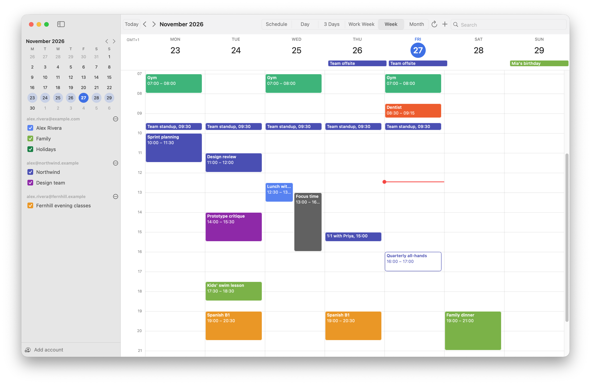

# Daymark

A native macOS calendar app that works like the Google Calendar app on iPhone. Sign in to each of
your Google accounts, and all of their calendars appear together in one window.



- Native SwiftUI, macOS 14 or later.
- No server and no database. Events are fetched live from the Google Calendar API and kept in
  memory only; Daymark's network connection keeps no cache or cookies on disk.
- What is stored on your Mac:
  - **Keychain:** your OAuth client and one sign-in token per account.
  - **App preferences:** the current view, which calendars are shown and the last calendar you
    used. These are identified by account email and calendar ID.
- Personal use. You create your own Google OAuth client (free, about 5 minutes, steps below).

> **Built with Claude.** Daymark was built by Gerasimos Pollatos working together with
> [Claude](https://www.anthropic.com/claude), Anthropic's AI model, in
> [Claude Code](https://claude.com/claude-code). Gerasimos set the goals, tried every build on a
> real Mac and reported what was wrong or missing. Claude wrote the code, the tests and this
> documentation. Claude also ran independent review rounds to find bugs and weak tests, then
> fixed what they found.

## Features

- **Views:** Schedule, Day, 3 Days, Work Week (Mon–Fri), Week and Month, plus a mini month
  calendar in the sidebar.
- **Several Google accounts at once:** each account's calendars are listed in the sidebar, with a
  coloured checkbox to show or hide each one.
- **Create events:**
  - Click an empty slot for a one-hour event, or drag to pick the exact times.
  - Click the all-day strip or a day in Month view for an all-day event.
  - Or use **+** / ⌘N.
- **Edit events:**
  - Drag an event to another time or day.
  - Drag its bottom edge to change its length.
  - Or open it and click Edit to change the title, times, guests, location, description or Google
    Meet. New events can also repeat.
- **Invitations:** answer Yes / No / Maybe, join Google Meet, and see guests and their replies.
- **Delete** one occurrence of a repeating event or the whole series.
- **Search** across all the calendars you're showing.
- **Reminders:** desktop notifications before events, using each event's Google Calendar reminders.
- **Refresh:** every 5 minutes, and when you switch back to the app (if the last refresh was more
  than a minute ago).

Keyboard shortcuts:

| Shortcut | Action |
|---|---|
| ⌘N | New event |
| ⌘T | Go to today |
| ⌘← / ⌘→ | Previous / next |
| ⌘1 … ⌘6 | Schedule, Day, 3 Days, Work Week, Week, Month |
| ⌘R | Refresh |
| ⌘, | Settings (Google client, notifications) |

## Requirements

- A Mac with macOS 14 (Sonoma) or later.
- Xcode, or the Xcode Command Line Tools, with Swift 5.10 or later. Install Xcode from the
  App Store, open it once, then check that `swift --version` works in Terminal.
- A Google account. Any number of accounts can be added later.

## Try it without a Google account

Daymark has a demo mode with three fictional accounts and a week of made-up events. Nothing
touches your Keychain, the network or your real calendars, and nothing is saved. After building
(see "Build and install" below):

```sh
open -n /Applications/Daymark.app --args --demo
```

The screenshot above was taken in demo mode.

## 1. Create your Google OAuth client (once)

Google only lets an app sign in with an OAuth client of its own, so you create one for your copy
of Daymark.

1. **Create a project:** https://console.cloud.google.com/projectcreate. Name it (for example
   "Daymark"), click **Create**, and make sure it's selected in the top bar.
2. **Enable the Calendar API:**
   https://console.cloud.google.com/apis/library/calendar-json.googleapis.com → **Enable**.
3. **Set up the consent screen:** https://console.cloud.google.com/auth/overview → **Get started**.
   - App name: `Daymark`. User support email: yours.
   - Audience: **External**.
   - Contact email: yours.
   - Agree to the terms and click **Create**.
4. **Check Branding:** https://console.cloud.google.com/auth/branding. App name, User support
   email and Developer contact email must be filled in. Leave the logo, home page, privacy policy
   and domains empty. A greyed-out **Save** button just means nothing has changed.
5. **Add yourself as a test user:** https://console.cloud.google.com/auth/audience → **Test users**
   → **Add users**. Add every Google account you'll connect to Daymark.
   - While the app is in "Testing", Google expires sign-ins after **7 days**. Daymark then shows a
     red warning next to the account; click it to sign in again.
   - To avoid that, **Publish app** on the same page. Google only allows publishing once Branding
     has an app home page, a privacy policy link and a matching authorized domain, all on a domain
     you control (a free GitHub Pages site works). You don't need Google's verification for
     personal use.
6. **Create the client:** https://console.cloud.google.com/auth/clients → **Create client**.
   - Application type: **Desktop app**. Name: anything.
   - Click **Create**, then **Download JSON**, or copy the Client ID and Client secret.

The client ID and secret are stored only in your Keychain. After importing the JSON file into
Daymark you can delete it from Downloads. Don't commit it, or the client ID and secret, to the
repository; `.gitignore` already excludes `client_secret*.json`.

## 2. Build and install

```sh
git clone https://github.com/gpollatos/daymark.git
cd daymark
swift test                          # optional: run the test suite
./scripts/build-app.sh --install    # builds Daymark.app and copies it to /Applications
```

The script builds a release binary, wraps it in `build/Daymark.app`, generates the app icon on the
first run, signs the app and, with `--install`, copies it to `/Applications`. If copying there
isn't allowed, run `INSTALL_DIR=~/Applications ./scripts/build-app.sh --install` instead.

To update after pulling changes, quit Daymark (⌘Q), run the same command, and open it again.

### Recommended: sign with your free Apple developer certificate

macOS only allows **Notification Center** for apps signed with an Apple developer certificate.
Without one, Daymark is signed "ad hoc". It still works, but:

- Reminders appear as Daymark's own cards in the top-right corner instead of real macOS
  notifications.
- macOS asks for Keychain access again after every rebuild.

To get a free certificate (once):

1. Open **Xcode → Settings → Accounts**, click **+** and sign in with your Apple ID.
2. Select your **(Personal Team)** → **Manage Certificates…** → **+** → **Apple Development**.
3. Check it's usable:

   ```sh
   security find-identity -v -p codesigning
   ```

   It should list `Apple Development: … (…)` and say `1 valid identities found`.

   If it says `0 valid identities found` (or `CSSMERR_TP_NOT_TRUSTED`), your Mac is missing
   Apple's current intermediate certificate. Download **Worldwide Developer Relations – G3** from
   https://www.apple.com/certificateauthority/ (`AppleWWDRCAG3.cer`), double-click it to add it to
   your login keychain, and check again.
4. Rebuild with `./scripts/build-app.sh --install`. It finds your certificate and prints
   `Signed with your Apple Development certificate`. If macOS asks whether `codesign` may use the
   key, enter your password and click **Always Allow**.

The build always uses the certificate in **your** Keychain. Nothing about anyone else's
certificate is in this repository. Don't share a built `Daymark.app`, though: it's signed with
your certificate, which contains your Apple ID email and team ID.

## 3. First launch

1. Open **Daymark** from Applications or Spotlight (⌘Space, type "Daymark").
2. On the setup screen, click **Import JSON…** and choose the file you downloaded, or paste the
   Client ID and secret. Click **Continue**.
3. Your browser opens Google's sign-in page:
   - Choose an account.
   - On "Google hasn't verified this app", click **Advanced → Go to Daymark**. It's your own app.
   - Tick every permission box, including calendar access, and click **Continue**.
   - When the tab says "Signed in", close it.
4. If macOS asks:
   - **Keychain access:** click **Always Allow**.
   - **Notifications:** click **Allow**.
5. Add more accounts with **Add account** at the bottom of the sidebar.

To check reminders work: **⌘, → Notifications → Send Test Reminder**.

Reminders only fire while Daymark is running. Closing the window keeps it running; quitting doesn't.
To start it at login: System Settings → General → Login Items → add Daymark.

## Troubleshooting

| Problem | Fix |
|---|---|
| Warning: "The Google Calendar API isn't enabled for your OAuth client's project" | Setup step 2: enable the Calendar API in the same Google Cloud project as your OAuth client, then press ⌘R. |
| "To publish your app, you must complete your configuration on the Branding page" | Use Testing mode with test users (setup step 5), or add the home page, privacy policy and domain that publishing needs. |
| "Access blocked" or "Error 403: access_denied" when signing in | Add that Google account as a test user (setup step 5). |
| Red warning next to an account | Its sign-in expired or was revoked (in Testing mode, every 7 days). Click it to reconnect. |
| Orange warning next to an account | Google couldn't be reached. Click to retry; it clears when Google answers. |
| A work or school account is blocked | That organisation's admin doesn't allow unverified apps. Only the admin can change it. |
| Settings → Notifications says "Using Daymark's own reminder windows" | The app is signed ad hoc. Follow "Sign with your free Apple developer certificate". |
| Settings → Notifications says notifications are turned off | System Settings → Notifications → Daymark → Allow notifications. |
| Keychain asks for access after every rebuild | Same cause: sign with an Apple Development certificate. |
| Signing in again says Daymark needs new permissions | Daymark now asks for narrower calendar access than earlier versions. Approve once. |
| Daymark seems stuck after a rebuild | Look for a Keychain access prompt behind other windows and click **Always Allow**. |

## How it works

```
Sources/Daymark/
  App/        DaymarkApp (entry point, menus), AppEnvironment (injectable dependencies),
              Notifier (reminders: Notification Center or in-app cards), DemoMode
  Store/      CalendarStore: all app state, multi-account loading, writes, search, reminders
  API/        GoogleCalendarAPI (REST client: retries, paging, encoding), HTTP (no-cache
              session), DTOs (wire types)
  Auth/       OAuthService + OAuthBackend (PKCE, loopback redirect), LoopbackServer,
              Credentials (Account, OAuthClient), Vault + Keychain
  Model/      CalendarEvent + GCalendar, EventDraft, ViewMode, errors
  Layout/     Pure grid logic: DayLayout (overlaps), DayAgenda, GridInteraction
              (click, drag, move)
  Support/    Dates (RFC 3339, calendar helpers), Fmt (text), Palette, SafeLink
  Views/      SwiftUI views (time grid, month, schedule, editor, sidebar, settings)
Tests/DaymarkTests/
  Support/    FakeGoogle, FakeOAuth, MemoryVault, MemoryPreferences, FakeNotifier, Gate,
              World (fixtures)
  *.swift     test suites, grouped by area (see Tests below)
scripts/      build-app.sh (bundle, sign, install), make-icon.swift
Resources/    Info.plist
```

- **Sign-in:** OAuth 2.0 authorization code flow with PKCE. Google redirects to a one-shot
  listener on `127.0.0.1`, Google's recommended flow for desktop apps. The listener ignores any
  request that doesn't carry the sign-in's random `state`.
- **Scopes:** `openid`, `email`, `calendar.calendarlist.readonly` (list your calendars) and
  `calendar.events` (read and write events). Daymark can't change sharing or delete calendars.
- **Removing an account** revokes its token at Google. If you were offline at the time, remove
  Daymark's access at https://myaccount.google.com/permissions.
- **Links from invitations** (Meet links, links in descriptions) only open if they're web links.
- **Loading:** about three months around the selected date are fetched at a time, at most six
  requests at once.
  - Google's rate limits and server errors are retried with backoff. Network errors aren't
    retried; the next refresh tries again.
  - A calendar that fails keeps showing its last known events.
- **Writes:** edits send only the fields that changed (PATCH). RSVPs send only your own reply.
  Guests are emailed when you invite them, change or cancel a meeting you organise, or answer an
  invitation.

## Tests

```sh
swift test                         # the whole suite runs in under a second
TZ=Pacific/Auckland swift test     # the suite doesn't depend on the Mac's time zone
```

The tests never touch Google, the network or your Keychain. `FakeGoogle` is a stateful fake of
the Calendar API. It knows which account each access token belongs to and returns 404 for another
account's calendar, so data sent to the wrong account shows up as a failure. The standard test
world is three accounts at noon on 26 Nov 2026 in New York, including:
- a calendar shared between two of the accounts;
- a holiday calendar whose ID contains `#`.

| File | Covers |
|---|---|
| `MultiAccountTests` | Merging, per-account routing, visibility, token refresh and rotation, failing or revoked accounts, accounts added or removed mid-load |
| `AccountLifecycleTests` | Sign-in failures, re-sign-in, revoking, removing accounts mid-load or mid-search |
| `WriteTests`, `WriteRoutingTests` | The exact request for create, edit, delete and RSVP, for every account, and who gets emailed |
| `GridInteractionTests` | Clicking, dragging, moving and resizing on the day grid |
| `APITests` | URL encoding, pagination, retries and backoff, 401 handling, OAuth and PKCE |
| `NotificationTests` | Reminder planning, scheduling, in-app reminder windows |
| `NavigationAndSearchTests` | Loading windows, navigation, search |
| `DateAndLayoutTests`, `FormattingTests` | DST and time zones, day layout, parsing, text shown in the app, the vault |
| `PrivacyTests` | Nothing cached on disk; only web links opened |
| `DemoModeTests` | Demo mode loads fictional data and works without Google |

## Limitations

- Editing one occurrence of a repeating event changes only that occurrence ("this and following"
  isn't supported). Repeat options are offered only when creating an event.
- An event can't be moved to another calendar after it's created.
- Multi-day all-day events are drawn as one chip per day, not as one continuous bar.
- The Schedule view shows two months at a time.
- A meeting you're invited to in two of your accounts appears twice, as in the iPhone app.
- Reminders fire only while Daymark is running.

## Security

To report a security problem, see [SECURITY.md](SECURITY.md). Please don't open a public issue.

## Not affiliated with Google

Daymark is an independent project. It isn't made, endorsed or supported by Google. Google Calendar
and Google Meet are trademarks of Google LLC.

## License

[MIT](LICENSE) © 2026 Gerasimos Pollatos
